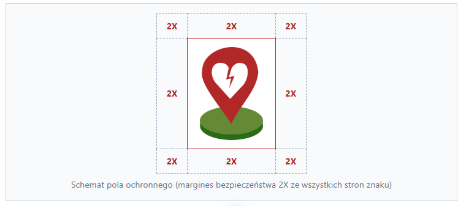

# Księga Znaku – Bliskie Sercu”

**Projekt:** Misja AED - Dane na ratunek 

## 1. Opis koncepcji i budowa znaku

Znak łączy symbol serca z charakterystycznym piorunem AED, dzięki czemu w prosty sposób komunikuje ratowanie życia i pierwszą pomoc. Całość bezpośrednio odzwierciedla dwuznaczność nazwy akcji **„Bliskie Sercu”** - z jednej strony wskazuje na fizyczną bliskość defibrylatora gotowego do natychmiastowego użycia, a z drugiej odwołuje się do empatii, troski o drugiego człowieka oraz wartości, które są nam najbliższe. Czerwony korpus przyciąga uwagę i buduje skojarzenie z sytuacją ratunkową, natomiast zielona podstawa nawiązuje do bezpieczeństwa, nadziei i gotowości do działania. Forma przypominająca znacznik lokalizacji podkreśla kluczowy cel projektu, czyli szybkie odnalezienie właściwego urządzenia w przestrzeni. Znak został zaprojektowany jako prosty i rozpoznawalny symbol, gotowy do wykorzystania na stronie, mapie, materiałach promocyjnych oraz w komunikacji partnerów.

## 2. Kolorystyka podstawowa

Znak składa się z trzech kolorów podstawowych oraz wycięcia (kanału alfa / transparentności) w kształcie serca i błyskawicy.

| Nazwa koloru | Rola w znaku | HEX | RGB | CMYK (druk) |
| --- | --- | --- | --- | --- |
| **Czerwień Ratunkowa** | Korpus pinezki (element główny) | `#b22828` | `rgb(178, 40, 40)` | `0, 78, 78, 30` |
| **Zieleń Dostępności** | Górna płaszczyzna podstawy | `#658a35` | `rgb(101, 138, 53)` | `27, 0, 62, 46` |
| **Ciemna Zieleń 3D** | Krawędź i cień podstawy | `#2b6a18` | `rgb(43, 106, 24)` | `59, 0, 77, 58` |
| **Transparentność (Wycięcie)** | Kształt serca oraz błyskawicy | *kanał alfa* | *przezroczysty* | *brak druku (wycięcie)* |

* **Zasada ekspozycji (tło):** Ze względu na przezroczystość serca i błyskawicy, znak należy umieszczać wyłącznie na jednolitych, kontrastowych tłach, aby zachować pełną czytelność wyciętego symbolu.

## 3. Pole ochronne

Za jednostkę konstrukcyjną (**moduł bazowy X**) przyjmuje się szerokość podstawy pinezki w miejscu jej styku z zielonym dyskiem (1/6 całkowitej szerokości zielonej podstawy). Wokół sygnetu wyznaczono pole ochronne wynoszące minimum **2X** z każdej ze stron (góra, dół, lewo, prawo), w którym nie mogą pojawiać się żadne inne elementy graficzne, teksty ani krawędzie formatu.

## 4. Minimalna wielkość reprodukcji

Ze względu na detal w postaci cienkiej błyskawicy wewnątrz wyciętego serca obowiązują następujące minimalne wymiary znaku:

| Nośnik / Medium | Minimalna wysokość sygnetu | Minimalna wysokość zestawienia z tekstem |
| :--- | :--- | :--- |
| **Media cyfrowe** (ekrany, aplikacje, WWW) | `24 px` | `32 px` |
| **Druk** (naklejki na kapsuły AED, ulotki, plakaty) | `10 mm` | `14 mm` |

## 5. Niedozwolone wykorzystywanie znaku

W celu ochrony spójności wizualnej oraz powagi misji ratowania życia zabrania się:

1. **Deformacji proporcji:** rozciągania, ściskania lub pochylania znaku w pionie bądź w poziomie.
2. **Wypełniania wycięcia kolorem:** wstawiania sztucznego koloru w miejsce przezroczystego serca lub błyskawicy (elementy te muszą pozostać transparentne).
3. **Ingerencji w kolorystykę:**  Zmiana kolorystyki podstawy oraz znacznika w sposób, który zaciera granicę między nimi. Dopuszcza się modyfikację barw znaku, ale podstawa musi zawsze wyraźnie odróżniać się kolorystycznie od znacznika.
4. **Obracania znaku:** przechylania sygnetu pod dowolnym kątem - pinezka musi zawsze wskazywać pionowo w dół.
5. **Modyfikacji elementów składowych:** usuwania zielonej podstawy, zmiany kształtu błyskawicy w sercu lub dodawania własnych obrysów.
6. **Umieszczania na niekontrastowym lub wzorzystym tle:** prezentowania znaku na fotografiach i teksturach, które prześwitując przez wycięte serce, zaburzałyby jego czytelność.

## 6. Zastosowanie

Znak może być wykorzystywany jako identyfikator akcji w portalu dane.gov.pl, na mapie AED, w materiałach informacyjnych, prezentacjach, mediach społecznościowych oraz materiałach partnerów udostępniających dane.

| Zastosowanie | Zasada |
| :--- | :--- |
| **Mapa / aplikacja** | Znak jako element identyfikacji akcji; nie zasłania informacji o AED. |
| **Strona internetowa** | Pełny znak na spokojnym, kontrastowym tle. |
| **Materiały drukowane** | Preferowane minimum 20 mm wysokości. |
| **Social media** | Można skalować, ale bez zmiany proporcji, kolorów i transparentności pioruna. |
| **Partnerzy / dysponenci danych** | Logo może towarzyszyć komunikatom o udostępnianiu i aktualizacji danych AED. |
